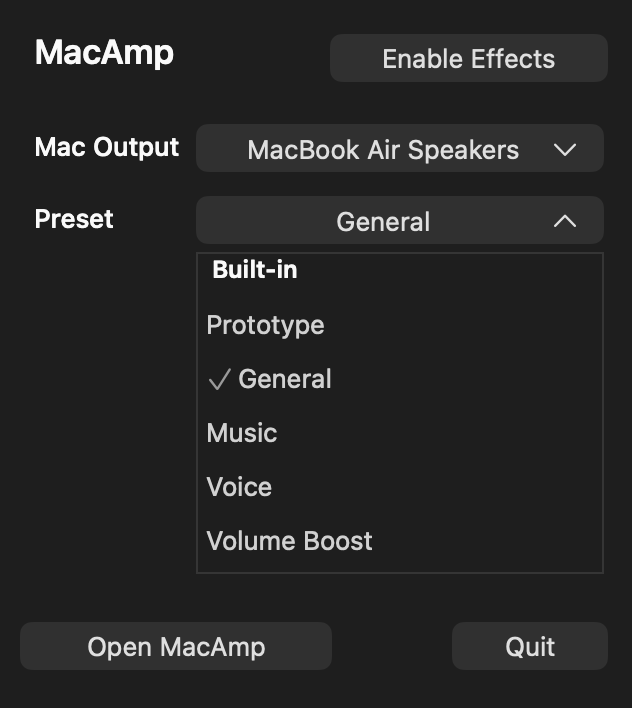
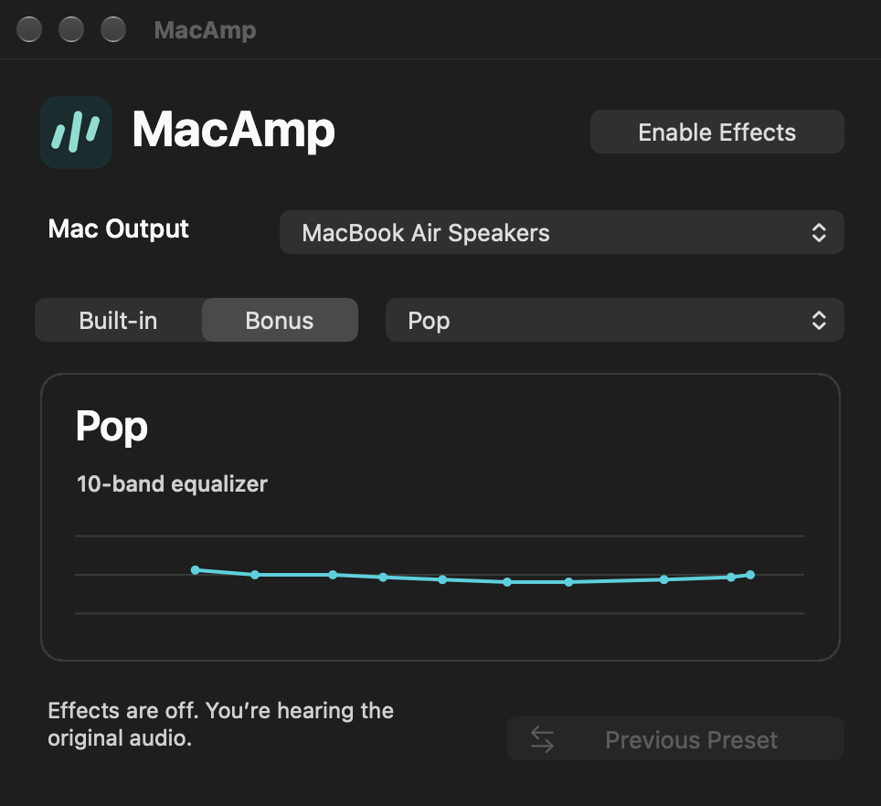

<p align="center"></p>

<h1 align="center">MacAmp</h1>

<p align="center">Boost your Mac’s audio with FxSound presets. Compare two presets while music plays and switch between speakers and headphones from the menu bar.</p>

<p align="center">
  <a href="#download">Download</a> ·
  <a href="#getting-started">Getting started</a> ·
  <a href="#features">Features</a> ·
  <a href="#screenshots">Screenshots</a> ·
  <a href="#documentation">Documentation</a>
</p>

## Download

| Platform | Download | Release notes |
| --- | --- | --- |
| Apple Silicon · macOS 14.2 or later | [Download MacAmp for Mac](https://github.com/Fikriazrbni/MacAmp/releases/download/v0.7.6/MacAmp-v0.7.6-macos-arm64.zip) | [v0.7.6](https://github.com/Fikriazrbni/MacAmp/releases/tag/v0.7.6) |

The app is ad hoc signed and has not been notarized by Apple. To verify the download, save the [SHA-256 checksum](https://github.com/Fikriazrbni/MacAmp/releases/download/v0.7.6/SHA256SUMS.txt) alongside the ZIP and run `shasum -a 256 -c SHA256SUMS.txt` in that folder. If macOS blocks the first launch and you trust the download, open **System Settings → Privacy & Security** and choose **Open Anyway** if available.

## Getting started

1. Unzip the download, move **MacAmp.app** to **Applications**, then open it. If you are upgrading from Power Audio, quit the old app first. MacAmp uses the same saved preset and intensity.
2. Click the **three-bar icon → Open MacAmp** to open the main window. MacAmp starts in the menu bar and stays out of the Dock and the ⌘ Tab switcher.
3. Play music or a video, choose your device under **Mac Output**, then click **Enable Effects**. Allow system audio recording when macOS asks.
4. Try **Built-in → Music**, then **Bonus → Pop**. Click **Previous Preset** to compare the two, or **Disable Effects** to hear the original audio.
5. Close the window to keep listening with the current effects. To exit the app, click the **three-bar icon → Quit**.

## Features

- **25 FxSound presets** across two collections, with 13 built-in presets and 12 bonus presets. The separate **Prototype** effect has an adjustable intensity of 50–150%.
- **Preset comparison** lets you switch back to the previous preset during playback. The main window shows the selected preset’s ten-band EQ curve.
- **Output switching** changes your Mac’s default sound device from the main window or menu bar. Active effects follow the new output and keep your preset.
- **Full-screen controls** let you open the output and preset lists below the three-bar icon while another app is in full screen. Select an item to apply it, or click the icon again to dismiss the panel.

## Screenshots

<p align="center">
  <br>
  <sub>Choose a preset directly from the menu bar.</sub>
</p>

<p align="center">
  <br>
  <sub>The main window shows the EQ curve for the selected preset.</sub>
</p>

## Privacy

While effects are enabled, MacAmp uses a Core Audio tap to capture audio playing in other apps and sends the processed sound to your selected output. This can include call audio played through that output. Processing happens in memory on your Mac. MacAmp does not save recordings, send audio to a server, or require an account.

## Documentation

- [v0.7.6 release notes](docs/release-v0.7.6.md) · [All releases](https://github.com/Fikriazrbni/MacAmp/releases)
- [App interface and Core Audio routing](MacAmp.mm) · [Preset processing](FxPreset.mm) · [Ambience effect](Ambience.hpp)
- [Preset and DSP credits](FxSound/NOTICE.txt) · [AGPL-3.0 license](LICENSE)

## Build locally

Install the Xcode Command Line Tools with a macOS SDK that includes Core Audio taps. From the repository root, run:

```sh
sh build.sh
open MacAmp.app
```

MacAmp uses Objective-C++, AppKit, Core Audio, and JavaScriptCore. The script builds for your Mac’s architecture, ad hoc signs the app, and tests the DSP at 44.1, 48, and 96 kHz. To rerun the tests without opening the interface:

```sh
./MacAmp.app/Contents/MacOS/MacAmp --test-dsp
```

<details>
<summary>Troubleshooting audio</summary>

Check that **Mac Output** shows the speaker or headset you want to use. If the status says **Waiting for audio**, play audio from another app. If you previously denied access, check MacAmp’s system audio recording permission in **System Settings → Privacy & Security**. Connect Bluetooth devices before selecting them. The audio engine supports compatible 32-bit float PCM streams and reports unsupported device formats in the main window.

</details>

MacAmp is an independent project by **Fikriazrbni**. Its presets and parts of its audio processing come from [FxSound](https://github.com/fxsound2/fxsound-app).
