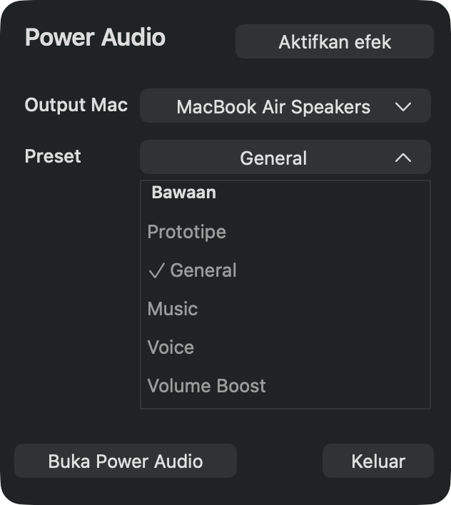
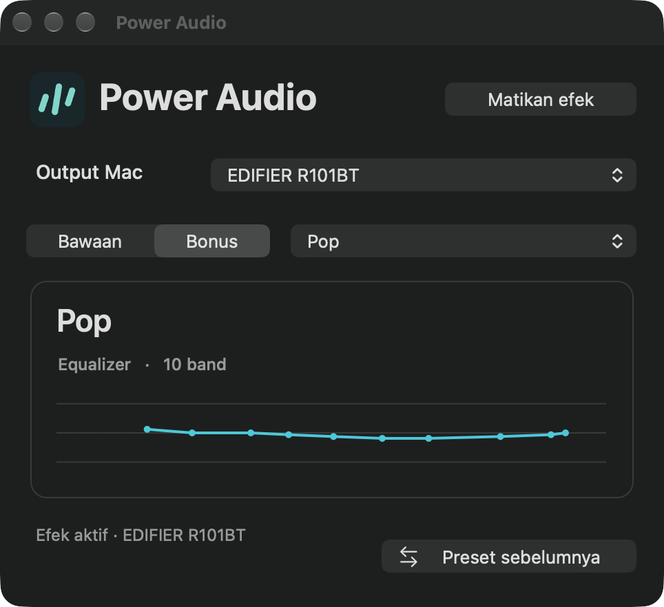

<p align="center"></p>

<h1 align="center">Power Audio</h1>

<p align="center">Atur karakter suara Mac dengan preset FxSound, bandingkan dua preset saat musik berjalan, dan pindahkan output langsung dari menu bar.</p>

<p align="center">
  <a href="#unduh">Unduh</a> ·
  <a href="#mulai-pakai">Mulai pakai</a> ·
  <a href="#fitur">Fitur</a> ·
  <a href="#tampilan">Tampilan</a> ·
  <a href="#dokumentasi">Dokumentasi</a>
</p>

## Unduh

| Platform | Paket | Catatan rilis |
| --- | --- | --- |
| macOS 14.2 ke atas · Apple Silicon | [Unduh Power Audio untuk Mac](https://github.com/Fikriazrbni/PowerAudio/releases/download/v0.7.4/PowerAudio-v0.7.4-macos-arm64.zip) | [v0.7.4](https://github.com/Fikriazrbni/PowerAudio/releases/tag/v0.7.4) |

Paket berisi aplikasi mandiri. Build memakai tanda tangan ad hoc dan belum dinotariskan oleh Apple. Jika macOS meminta verifikasi saat pertama dibuka, kamu bisa mencocokkan berkas unduhan dengan [checksum SHA-256](https://github.com/Fikriazrbni/PowerAudio/releases/download/v0.7.4/SHA256SUMS.txt). Jika kamu mempercayai unduhan ini, gunakan **Open Anyway** di **System Settings → Privacy & Security** bila tersedia.

## Mulai pakai

1. Ekstrak ZIP, pindahkan **Power Audio.app** ke **Applications**, lalu buka.
2. Putar musik atau video, pilih perangkat di **Output Mac**, lalu klik **Aktifkan efek**. Izinkan akses audio sistem saat macOS memintanya.
3. Coba **Bawaan → Music**, lalu **Bonus → Pop**. Klik **Preset sebelumnya** untuk berpindah di antara keduanya pada volume Mac yang sama.
4. Klik **Matikan efek** untuk mendengar audio asli. Untuk memakai kontrol ringkas, tutup jendela dan klik ikon tiga batang di menu bar. Pilih **Keluar** untuk menghentikan aplikasi.

## Fitur

- **25 preset FxSound** mencakup 13 pilihan bawaan dan 12 bonus. Pilihan **Prototipe** menyediakan pengaturan intensitas 50–150%. Aplikasi mengingat pilihan preset dan intensitas terakhir.
- **Perbandingan langsung** memungkinkan kamu berganti preset saat audio sedang diputar. Grafik statis menampilkan pengaturan sepuluh band EQ pada preset FxSound.
- **Pemilih output Mac** mengganti perangkat keluaran default sistem dari jendela atau menu bar. Saat efek aktif, Power Audio mengikuti perpindahan output dan mempertahankan preset.
- **Panel menu bar** terbuka di bawah ikon tiga batang, termasuk saat aplikasi lain fullscreen. Klik **Output Mac** atau **Preset** untuk membuka daftar tepat di bawah kontrolnya. Daftar menutup setelah kamu memilih.

## Tampilan

<p align="center">
  <br>
  <sub>Klik ikon tiga batang dekat notch, lalu pilih <b>Preset</b>. Daftarnya terbuka langsung di bawah pilihan aktif.</sub>
</p>

<p align="center">
  <br>
  <sub>Preset Pop aktif pada speaker Bluetooth di Power Audio v0.7.</sub>
</p>

## Privasi

Saat efek aktif, Power Audio menggunakan Core Audio Tap untuk membaca suara yang diputar aplikasi lain dan meneruskan hasil pemrosesan ke output pilihanmu. Suara panggilan yang terdengar melalui output juga dapat ikut diproses. Pemrosesan berlangsung di memori Mac. Aplikasi tidak merekam audio ke berkas, mengirim sampel audio ke server, atau memerlukan akun.

## Dokumentasi

- [Catatan rilis v0.7.4](docs/release-v0.7.4.md) · [Semua rilis](https://github.com/Fikriazrbni/PowerAudio/releases)
- [Antarmuka dan routing Core Audio](PowerAudio.mm) · [Pemrosesan preset](FxPreset.mm) · [Efek ambience](Ambience.hpp)
- [Asal preset dan komponen DSP](FxSound/NOTICE.txt) · [Lisensi AGPL-3.0](LICENSE)

<details>
<summary>Build dan tes lokal di macOS</summary>

Pasang Xcode Command Line Tools dengan SDK macOS yang menyediakan Core Audio Taps, lalu jalankan dari root repo.

```sh
sh build.sh
open "Power Audio.app"
```

Build memakai Objective-C++, AppKit, Core Audio, dan JavaScriptCore bawaan macOS. Skrip menyusun bundle untuk arsitektur mesin build, memberi tanda tangan ad hoc, lalu menjalankan tes DSP untuk preset pada 44,1, 48, dan 96 kHz. Untuk mengulang tes tanpa membuka jendela, jalankan perintah berikut.

```sh
"./Power Audio.app/Contents/MacOS/PowerAudio" --test-dsp
```

</details>

<details>
<summary>Jika suara belum terdengar</summary>

Pastikan nama perangkat di **Output Mac** sesuai dengan speaker atau headset yang digunakan. Jika status menunggu audio, putar audio dari aplikasi lain. Periksa izin perekaman audio sistem untuk Power Audio di **Privacy & Security** jika izin sebelumnya ditolak. Perangkat Bluetooth perlu tersambung ke Mac agar muncul di daftar. Jalur real-time mendukung format PCM float 32-bit yang kompatibel; format dan mode perangkat lain dapat memicu pesan kesalahan.

</details>

Power Audio adalah proyek independen oleh **Fikriazrbni**. Preset dan bagian pemrosesan suara berasal dari [FxSound](https://github.com/fxsound2/fxsound-app).
